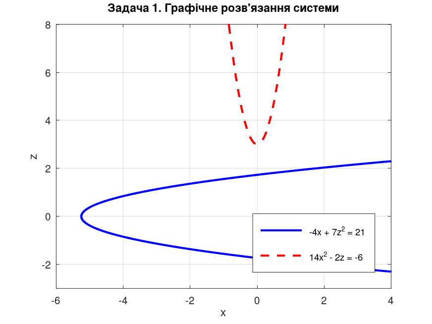
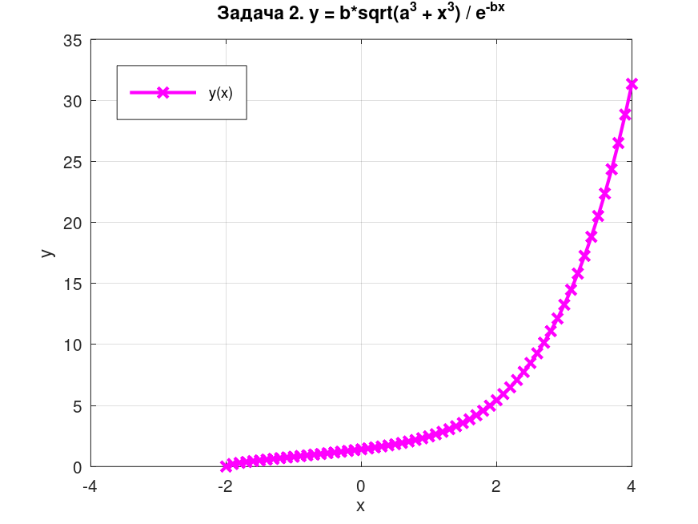
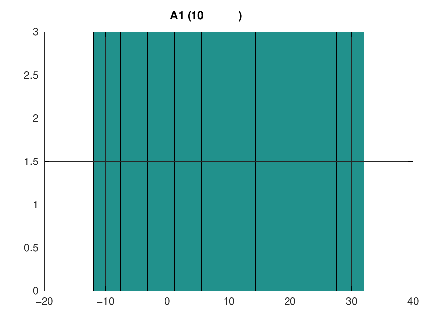
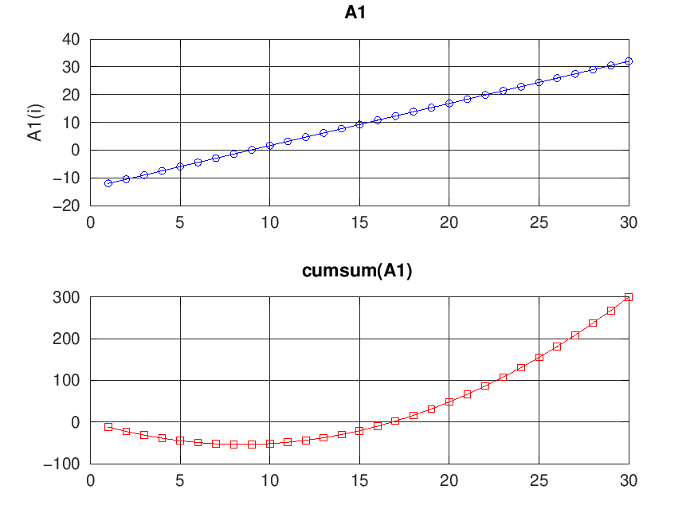
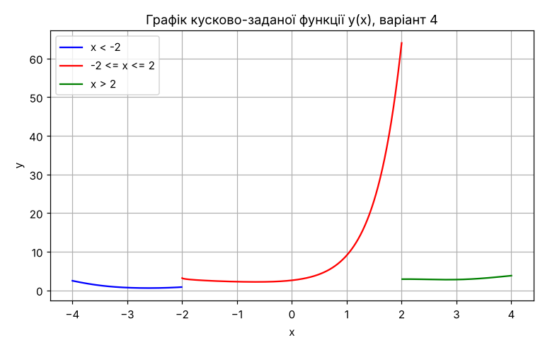

# Лабораторні роботи з програмування в GNU Octave / MATLAB

Лабораторні роботи з курсу програмування в середовищі GNU Octave (сумісно з MATLAB).
Усі завдання виконано за **варіантом № 4**.

## Зміст

| № | Тема | Файли |
|---|------|-------|
| 1 | Обчислення арифметичних виразів, символьна перевірка формул | [lab1.m](lab1.m) |
| 2 | Операції з матрицями і масивами. Розв'язування СЛАР матричним способом | [lab2.m](lab2.m), [lab2.txt](lab2.txt) |
| 3 | Двовимірна графіка | [lab3.m](lab3.m), [lab3.txt](lab3.txt) |
| 4 | Статистична обробка даних | [lab4.m](lab4.m), [lab4.txt](lab4.txt) |
| 5 | Програми лінійної структури | [lab5.m](lab5.m) |
| 6 | Розгалужені обчислювальні процеси | [lab6_1.m](lab6_1.m), [lab6_2.m](lab6_2.m) |

## Як запустити

1. Встановити [GNU Octave](https://octave.org/download) (або використати MATLAB).
2. Для лаб 1 і 3 потрібен пакет `symbolic`:
   ```octave
   pkg install -forge symbolic
   ```
3. Перейти в папку репозиторію й запустити скрипт за назвою, наприклад:
   ```octave
   cd octave-labs
   lab4
   ```

Скрипти, що використовують `diary`, зберігають вивід командного вікна у файл `labN.txt`,
а графіки — у `.png`.

---

## Лабораторна робота № 1. Обчислення арифметичних виразів

Програма вводить `x`, `y`, `z` з клавіатури (`input`), обчислює два складні вирази `a` і `b`
(логарифми, тригонометричні функції, корені, модулі) та перевіряє запис формул
у символьному вигляді (`syms`, `pretty`).

## Лабораторна робота № 2. Матриці, масиви, СЛАР

**Частина 1.** Формування векторів (`linspace`, діапазон з кроком), поелементні операції,
складання матриці з векторів, діагональна матриця `diag`, пошук елементів у проміжку (`find`).

**Частина 2.** Розв'язання системи лінійних рівнянь трьома способами:
`A^(-1)*B`, `inv(A)*B` та `A\B`, з перевіркою нев'язки.

## Лабораторна робота № 3. Двовимірна графіка

- **Задача 1.** Графічне розв'язання нелінійної системи
  `-4x + 7z² = 21`, `14x² - 2z = -6` (криві не перетинаються — дійсних розв'язків немає,
  що підтверджено через `solve`).
- **Задача 2.** Графік функції `y = b·√(a³ + x³) / e^(-bx)` на проміжку `[-4, 4]`,
  розміщення графіків у одному вікні (`subplot`).

<p align="center">
  
  
</p>

## Лабораторна робота № 4. Статистична обробка даних

Формування масиву `A1(30)` і матриці `A2(3×15)`, обчислення `max`, `min`, `mean`, `median`,
`std`, сортування (`sort`, `sortrows`), `sum`, `prod`, `cumsum`, `cumprod`, `diff`,
побудова гістограми (`hist`).

<p align="center">
  
  
</p>

## Лабораторна робота № 5. Програми лінійної структури

Обчислення площі трикутника за **формулою Герона**:

```
p = (a + b + c) / 2
S = √( p(p − a)(p − b)(p − c) )
```

Два способи введення-виведення: `input` / `disp` та діалогове вікно `inputdlg`
(з перетворенням `str2double` / `num2str`).

| a, b, c | p | S |
|---------|---|---|
| 3, 4, 5 | 6 | 6 |
| 5, 6, 7 | 9 | 14.6969 |

## Лабораторна робота № 6. Розгалужені обчислювальні процеси

**Завдання 1** (`lab6_1.m`) — обчислення кусково-заданої функції через `if … elseif … else`:

```
      ⎧ 2.3·∛(x − 1.3) + sin²x,      x > 2
y =   ⎨ arccos(x/2) + 2^(3x),        −2 ≤ x ≤ 2
      ⎩ |x|^(sin x) − lg|x + 1.5|,   x < −2
```

Також побудовано графік функції за допомогою логічних масок (без циклів і `if`).

<p align="center"></p>

**Завдання 2** (`lab6_2.m`) — квадратне рівняння `a·x² + b·x + c = 0`, вибір формули
через `switch` залежно від знаку дискримінанта:

| Умова | Обчислення |
|-------|-----------|
| D < 0 | y = a² − 9bc, «Корені відсутні» |
| D = 0 | y = 4·x₁ |
| D > 0 | y = x₂·sin x₁ |

Для даних варіанта (`a = 7.2, b = 5.3, c = −3.6`): `D = 131.77`, `x₁ = −1.165`, `x₂ = 0.429`, `y = −0.394`.
